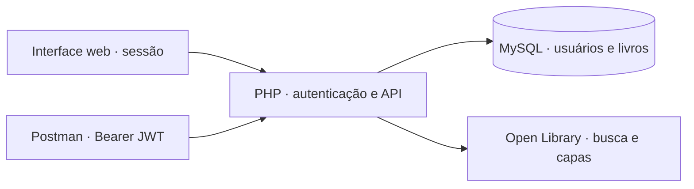

# Open Library API · Lista de leitura

Aplicação web para pesquisar, cadastrar e organizar livros, desenvolvida em **PHP 8, MySQL e JavaScript**. O projeto reúne interface com login por sessão, API JSON protegida por **JWT com permissões** e integração com a Open Library.

Desenvolvido para a disciplina **Linguagem de Programação VIII**.

[Instalação](#instalação-no-xampp) · [API](#referência-da-api) · [JWT](#autenticação-e-permissões) · [Postman](#coleções-postman) · [Apresentação](#apresentação)

## Sumário

- [Visão geral](#visão-geral)
- [Tecnologias e arquitetura](#tecnologias-e-arquitetura)
- [Requisitos](#requisitos)
- [Instalação no XAMPP](#instalação-no-xampp)
- [Configuração](#configuração)
- [Autenticação e permissões](#autenticação-e-permissões)
- [Referência da API](#referência-da-api)
- [Coleções Postman](#coleções-postman)
- [Banco de dados](#banco-de-dados)
- [Estrutura do projeto](#estrutura-do-projeto)
- [Verificações automatizadas](#verificações-automatizadas)
- [Solução de problemas](#solução-de-problemas)
- [Apresentação](#apresentação)

## Visão geral

O sistema permite manter uma lista de leitura com dados persistidos no MySQL. Os livros podem ser cadastrados manualmente ou encontrados por uma pesquisa na Open Library.

### Funcionalidades

- Cadastro de contas, login e logout na interface web.
- Painel protegido para consultar, cadastrar e editar livros.
- Exclusão de livros restrita ao perfil `admin`.
- Busca por título, autor ou assunto, com salvamento do primeiro resultado da Open Library.
- Exibição de capas quando a obra possui essa informação.
- Login da API com body JSON e emissão de JWT válido por uma hora.
- Permissões explícitas no token e validação contra o perfil atual no banco.
- Coleções Postman com exemplos de requisições, respostas e casos de erro.

**Escopo dos dados:** a lista de livros é compartilhada entre as contas autenticadas. O cadastro de um livro não o vincula a um usuário específico.

## Tecnologias e arquitetura

| Componente | Tecnologia | Responsabilidade |
|---|---|---|
| Interface | HTML, CSS e JavaScript | Formulários, lista e chamadas `fetch` |
| Aplicação | PHP 8 | Sessões, regras de acesso, validação e respostas JSON |
| Persistência | MySQL/MariaDB com PDO | Armazenamento e consultas preparadas |
| Autenticação da API | JWT assinado com HS256 | Identidade, perfil, permissões e validade |
| Integração externa | Open Library, via cURL | Busca de obras e obtenção de capas |
| Ambiente local | Apache/XAMPP | Execução do PHP e acesso ao banco |
| Demonstração da API | Postman | Login, CRUD e verificação dos retornos HTTP |



As senhas usam `password_hash()` e `password_verify()`. A geração e a validação do JWT usam funções nativas do PHP, incluindo `hash_hmac()`, `hash_equals()`, Base64URL e JSON. A aplicação não exige instalação de pacotes com Composer ou npm.

## Requisitos

- Git, para clonar o repositório.
- Apache e PHP 8 com `pdo_mysql`, `mbstring` e `curl` habilitados.
- MySQL ou MariaDB compatível com [database.sql](database.sql).
- Navegador atualizado e Postman para executar as coleções fornecidas.
- Internet para a busca e as capas da Open Library.

O cadastro manual e a gestão dos livros já salvos não dependem da Open Library.

## Instalação no XAMPP

### 1. Clonar o projeto

No PowerShell, execute:

```powershell
cd C:\xampp\htdocs
git clone https://github.com/kauanbuenodev/open-library-api.git open-library-trabalho
cd open-library-trabalho
```

O nome local `open-library-trabalho` mantém os endereços usados nas coleções Postman. Também é possível baixar o ZIP do repositório e extrair os arquivos para essa pasta.

### 2. Iniciar os serviços e importar o banco

1. No painel do XAMPP, inicie **Apache** e **MySQL**.
2. Abra [phpMyAdmin](http://localhost/phpmyadmin/).
3. Selecione **Importar** e envie [database.sql](database.sql).

O script cria `open_library_app`, as tabelas `usuarios` e `lista_leitura` e dois livros de exemplo. Não cria contas nem apaga registros existentes. Em instalações anteriores, `CREATE TABLE IF NOT EXISTS` também não modifica a estrutura de tabelas já existentes.

### 3. Conferir a configuração

Revise [api/config.php](api/config.php). Os valores iniciais consideram o MySQL local do XAMPP, com usuário `root` e senha vazia. Ajuste-os se sua instalação utilizar credenciais ou portas diferentes. Substitua também o contato de exemplo da Open Library por um contato real do responsável pelo projeto.

### 4. Acessar e cadastrar uma conta

Abra **[http://localhost/open-library-trabalho/](http://localhost/open-library-trabalho/)** e selecione **Cadastre-se**.

O cadastro exige nome de 2 a 100 caracteres, e-mail válido de até 150 caracteres e senha com pelo menos 8 caracteres. Contas novas recebem o perfil `usuario`.

Abra o projeto pelo Apache. Abrir o HTML como arquivo não executa o PHP nem disponibiliza a API. Se a porta do Apache ou o nome da pasta mudar, ajuste os endereços e a variável `baseUrl` do Postman.

### 5. Definir uma conta administradora

Cadastre a conta pela interface e execute no banco `open_library_app`, substituindo o e-mail pelo da conta escolhida:

```sql
UPDATE usuarios
SET perfil = 'admin'
WHERE email = 'admin@exemplo.com';
```

Na interface, saia e entre novamente para atualizar a sessão. Na API, faça novo login para emitir um JWT com `livros:excluir`.

## Configuração

As configurações estão em [api/config.php](api/config.php). Quando definidas no ambiente do processo PHP, as variáveis abaixo substituem os valores padrão.

| Variável | Padrão | Uso |
|---|---|---|
| `DB_HOST` | `127.0.0.1` | Endereço do banco |
| `DB_PORT` | `3306` | Porta do banco |
| `DB_NAME` | `open_library_app` | Nome do banco |
| `DB_USER` | `root` | Usuário do banco |
| `DB_PASSWORD` | Vazio | Senha do banco |
| `JWT_SECRET` | Chave local gerada automaticamente | Assinatura dos tokens |
| `OPEN_LIBRARY_USER_AGENT` | Identificador do projeto com contato de exemplo | Identificação das chamadas à Open Library |

O projeto **não carrega arquivos `.env` automaticamente**. Configure as variáveis no ambiente usado pelo Apache/PHP e reinicie o Apache quando necessário. Variáveis definidas apenas em um terminal não alteram um Apache já iniciado pelo painel do XAMPP.

### Chave e validade do JWT

- Algoritmo aceito: `HS256`.
- Validade padrão: `3600` segundos, em `jwt.ttl_seconds`.
- Emissor e audiência: `jwt.issuer` e `jwt.audience`.
- Sem `JWT_SECRET`, uma chave aleatória é persistida no diretório temporário do PHP, fora da pasta pública, identificada pelo caminho da instalação.
- Apagar essa chave ou mudar o projeto de caminho invalida os tokens anteriores.

Para uma instalação permanente, defina uma chave aleatória estável com pelo menos 32 bytes em `JWT_SECRET`. Para gerar um valor, execute localmente:

```powershell
C:\xampp\php\php.exe -r "echo bin2hex(random_bytes(32)), PHP_EOL;"
```

Guarde o valor no ambiente do servidor, fora do repositório. Em acessos fora do ambiente local, use HTTPS para proteger credenciais, cookies e tokens em trânsito.

## Autenticação e permissões

### Interface web e API

| Acesso | Autenticação | Funcionamento |
|---|---|---|
| Interface web | Sessão PHP | O formulário de `login.php` inicia a sessão usada pelo painel |
| API via Postman | JWT | `api/login.php` emite o token, enviado nas próximas chamadas como Bearer |

A API aceita sessão autenticada ou JWT válido. Se `Authorization` estiver presente, o Bearer tem prioridade: token inválido recebe `401`, mesmo havendo sessão autenticada.

### Login com JSON raw

```http
POST /open-library-trabalho/api/login.php
Content-Type: application/json
```

No Postman, selecione **Body → raw → JSON** e envie as credenciais de uma conta cadastrada:

```json
{
  "email": "usuario@exemplo.com",
  "senha": "senha-cadastrada"
}
```

Exemplo ilustrativo de resposta `200 OK`:

```json
{
  "success": true,
  "access_token": "<JWT retornado pelo servidor>",
  "token_type": "Bearer",
  "expires_in": 3600,
  "usuario": {
    "id": 2,
    "nome": "Usuário de exemplo",
    "email": "usuario@exemplo.com",
    "perfil": "usuario",
    "permissoes": ["livros:ler", "livros:criar", "livros:editar"]
  }
}
```

Use o `access_token` real retornado pelo login nas próximas requisições:

```http
Authorization: Bearer <access_token>
```

O token vai no cabeçalho; o body contém os dados da operação. O servidor define perfil e permissões a partir do banco. Informá-los no body do login não concede acesso adicional.

### Conteúdo do JWT

| Claim | Informação |
|---|---|
| `sub` | ID do usuário, como texto |
| `nome`, `email` | Dados públicos da conta |
| `perfil` | `usuario` ou `admin` |
| `permissoes` | Ações autorizadas no momento da emissão |
| `iss`, `aud` | Emissor e audiência esperados pela aplicação |
| `iat`, `nbf`, `exp` | Emissão, início da validade e expiração |
| `jti` | Identificador único do token |

Trecho ilustrativo de um payload administrativo:

```json
{
  "sub": "1",
  "nome": "Administrador",
  "email": "admin@exemplo.com",
  "perfil": "admin",
  "permissoes": [
    "livros:ler",
    "livros:criar",
    "livros:editar",
    "livros:excluir"
  ]
}
```

O payload é legível, não criptografado. Senha e hash não são incluídos. A assinatura é verificada antes de aceitar os claims; apenas decodificar o token não comprova sua autenticidade.

### Matriz de permissões

| Permissão | Operação | `usuario` | `admin` |
|---|---|:---:|:---:|
| `livros:ler` | Consultar livros e capas | Sim | Sim |
| `livros:criar` | Cadastrar manualmente ou pela busca | Sim | Sim |
| `livros:editar` | Atualizar um livro | Sim | Sim |
| `livros:excluir` | Remover um livro | Não | Sim |

Nas chamadas com JWT, a permissão precisa existir **no token e no perfil atual do banco**. Retirar `admin` bloqueia a exclusão imediatamente; conceder esse perfil exige novo login para obter a permissão adicional. Na interface, o perfil fica na sessão e é atualizado ao entrar novamente.

O logout encerra a sessão PHP e não revoga JWTs já emitidos. Não há endpoint de refresh nem lista de revogação. Validade, assinatura, existência do usuário e perfil atual continuam sendo verificados pela API.

## Referência da API

**URL base local:** `http://localhost/open-library-trabalho`

Envie `Content-Type: application/json` nos endpoints com body JSON. Rotas de livros e capas exigem autenticação.

| Método | Rota | Finalidade | Permissão | Sucesso |
|---|---|---|---|---|
| `POST` | `/api/login.php` | Autenticar e emitir JWT | Credenciais válidas | `200` |
| `GET` | `/api/books.php` | Listar livros | `livros:ler` | `200` |
| `GET` | `/api/books.php?id={id}` | Consultar um livro | `livros:ler` | `200` |
| `POST` | `/api/books.php` | Cadastrar manualmente ou buscar e salvar | `livros:criar` | `201` ou `200` |
| `PUT` | `/api/books.php?id={id}` | Atualizar um livro | `livros:editar` | `200` |
| `DELETE` | `/api/books.php?id={id}` | Excluir um livro | `livros:excluir` e perfil `admin` | `204` |
| `GET` | `/api/cover.php?id={cover_id}` | Obter imagem de capa | `livros:ler` | `200` com imagem |

### Consultar livros

```http
GET /open-library-trabalho/api/books.php
Authorization: Bearer <access_token>
```

A resposta contém `success: true` e `data` com a lista ordenada pelos cadastros mais recentes. Sem registros, `data` é `[]`. Para consultar um único livro, informe seu ID em `?id=123`; nesse caso, `data` contém um objeto.

### Cadastrar manualmente

```http
POST /open-library-trabalho/api/books.php
Authorization: Bearer <access_token>
Content-Type: application/json
```

```json
{
  "title": "Dom Casmurro",
  "authors": "Machado de Assis",
  "first_publish_year": 1899,
  "isbn": "9788535914849"
}
```

Retorna `201 Created`, `message: "Livro cadastrado."` e o registro em `data`. Guarde `data.id` para consultar, editar ou excluir esse livro.

| Campo | Regra |
|---|---|
| `title` | Obrigatório, de 1 a 255 caracteres após remover espaços nas extremidades |
| `authors` | Obrigatório, de 1 a 500 caracteres após remover espaços nas extremidades |
| `first_publish_year` | Opcional, inteiro de 1 a 2100; aceita ausência, `null` ou texto vazio |
| `isbn` | Opcional, texto de até 20 caracteres; não há validação de dígito verificador |

### Buscar na Open Library e salvar

Use o mesmo endpoint de cadastro, enviando `query` no body:

```json
{
  "query": "Frankenstein Mary Shelley"
}
```

A pesquisa aceita de 2 a 120 caracteres. O primeiro resultado é salvo. Uma obra nova retorna `201`; uma obra já identificada pela mesma `open_library_key` tem seus dados atualizados e retorna `200`. Sem resultado, retorna `404`.

### Editar um livro

```http
PUT /open-library-trabalho/api/books.php?id=123
Authorization: Bearer <access_token>
Content-Type: application/json
```

```json
{
  "title": "Dom Casmurro — edição revisada",
  "authors": "Machado de Assis",
  "first_publish_year": 1899,
  "isbn": "9788535914849"
}
```

Substitua `123` pelo ID real. O retorno é `200` com o livro atualizado. O `PUT` exige título e autores; envie também ano e ISBN para preservá-los, pois esses campos opcionais são definidos como `null` quando omitidos.

### Excluir um livro

1. Liste os livros e copie o `id` desejado.
2. Faça login com uma conta `admin` e obtenha seu token.
3. Envie o ID na URL e o token no cabeçalho. **Não envie body.**

```http
DELETE /open-library-trabalho/api/books.php?id=123
Authorization: Bearer <access_token_do_admin>
```

`204 No Content`, com corpo vazio, confirma a exclusão. Usuário comum recebe `403`; um ID inexistente ou já excluído recebe `404` quando a conta tem permissão. O ID `123` é ilustrativo: use um registro retornado pela sua instalação.

### Obter uma capa

`GET /api/cover.php?id={cover_id}` entrega a imagem pela integração com a Open Library. O parâmetro é o **identificador da capa**, disponível em `cover_id`, e não o ID do livro na tabela. A resposta é uma imagem, não um objeto JSON de livro.

### Códigos de resposta

| Código | Significado no projeto |
|---|---|
| `200` | Consulta, atualização ou login concluído; obra existente atualizada pela busca |
| `201` | Livro cadastrado |
| `204` | Livro excluído, sem body de resposta |
| `400` | JSON malformado, corpo que não é objeto ou identificador inválido |
| `401` | Credenciais incorretas, autenticação ausente ou JWT inválido/expirado |
| `403` | Usuário autenticado sem permissão para a ação |
| `404` | Livro, resultado de pesquisa ou capa não encontrado |
| `405` | Método HTTP não permitido |
| `415` | Login da API com Content-Type diferente de `application/json` |
| `422` | Dados de cadastro/edição ou campos de login inválidos |
| `500` | Falha interna, configuração incorreta ou indisponibilidade do banco |
| `502` | Falha de comunicação ou resposta inválida da busca Open Library |

Erros JSON usam `success: false` e `error`. Falhas de validação de livros também incluem `errors`:

```json
{
  "success": false,
  "error": "Você não tem permissão para esta ação."
}
```

## Coleções Postman

| Arquivo | Conteúdo |
|---|---|
| [Coleção principal](postman/Open_Library_Trabalho.postman_collection.json) | 20 requisições: API pública, login comum/admin, CRUD e casos de erro |
| [Coleção simplificada](postman/Open_Library_JWT.postman_collection.json) | 6 requisições para o fluxo básico com JWT e JSON raw |
| [Guia de exemplos](postman/EXEMPLOS.md) | Instruções de cada chamada e passo a passo de exclusão |

As coleções têm **32 exemplos salvos de resposta**, somadas. Expanda a seta ao lado da requisição para abrir um exemplo e consulte **Description** para as instruções. Tokens e IDs dos exemplos são ilustrativos.

### Configurar a coleção principal

Importe o JSON no Postman e ajuste as variáveis da coleção:

| Variável | Preenchimento |
|---|---|
| `baseUrl` | `http://localhost/open-library-trabalho` |
| `userEmail` | E-mail de uma conta com perfil `usuario` |
| `adminEmail` | E-mail de uma conta com perfil `admin` |
| `password` | Senha cadastrada; a coleção principal usa a mesma variável para as duas contas |
| `openLibraryUserAgent` | Identificador da aplicação com contato real |
| `bookId` | Preenchido pelo cadastro ou definido com o ID escolhido na listagem |
| `userToken`, `adminToken`, `token` | Preenchidos automaticamente pelos logins |
| `userJwtPayload`, `adminJwtPayload` | Payloads decodificados, salvos pelos testes de login para inspeção |

Para usar senhas distintas na coleção principal, ajuste o body dos respectivos logins. A coleção simplificada utiliza `email`, `senha`, `token`, `bookId` e `jwtPayload`.

### Sequência de demonstração

1. Execute **02 — Login JWT usuário comum**.
2. Execute **05 — Cadastrar livro manual**; o teste salva `data.id` em `bookId`.
3. Execute **06 — Buscar livro por ID** e **07 — Atualizar livro**.
4. Execute **13 — Usuário comum não pode excluir** para observar o `403`.
5. Execute **16 — Login JWT administrador** para preencher `adminToken`.
6. Execute **17 — Administrador exclui** com `Params → id = {{bookId}}`; o retorno esperado é `204` vazio.

Para remover outro livro, consulte **04 — Listar livros** e altere `bookId` antes da chamada **17**. A chamada **13** demonstra a restrição e não realiza a exclusão.

As requisições da coleção principal desativam cookies para demonstrar JWT. A execução completa começa com **01**, que limpa os tokens e o ID de uma execução anterior. A consulta pública **00** e a busca **03** dependem de internet.

## Banco de dados

[database.sql](database.sql) define o banco `open_library_app` com codificação `utf8mb4`.

| Tabela | Dados armazenados |
|---|---|
| `usuarios` | ID, nome, e-mail único, hash da senha e perfil |
| `lista_leitura` | ID, chave da obra, título, autores, ano, ISBN, capa, termo da busca e datas de criação/atualização |

`open_library_key` é única e identifica as obras importadas. Cadastros manuais recebem uma chave local aleatória. Não existe chave estrangeira entre usuário e livro: a lista é compartilhada.

As consultas com parâmetros usam PDO e prepared statements. A senha original não é persistida; somente o resultado de `password_hash()` é salvo em `usuarios.senha_hash`.

## Estrutura do projeto

```text
open-library-trabalho/
├── api/
│   ├── bootstrap.php             # PDO, busca externa e funções de apoio
│   ├── books.php                 # CRUD de livros
│   ├── config.php                # Configuração de banco, JWT e Open Library
│   ├── cover.php                 # Entrega de imagens de capa
│   └── login.php                 # Login JSON e emissão de JWT
├── includes/
│   ├── api.php                   # JSON, autenticação e autorização da API
│   ├── auth.php                  # Sessões e proteção das páginas
│   ├── jwt.php                   # Assinatura e validação do token
│   ├── livros.php                # Validação e persistência de livros
│   ├── permissoes.php            # Permissões por perfil
│   └── usuarios.php              # Cadastro e consulta de contas
├── postman/                      # Coleções e guia de exemplos
├── tests/jwt.php                 # Verificações de JWT e integração HTTP
├── Pdfs novo/                    # Material de referência das aulas
├── cadastro.php                  # Cadastro pela interface
├── login.php / logout.php        # Acesso por sessão
├── index.php / painel.php        # Entrada e painel protegido
├── app.js / styles.css           # Comportamento e apresentação da interface
├── index.html / index-legacy.html # Arquivos estáticos legados
├── database.sql                  # Estrutura e registros iniciais
├── apresentacao_open_library.pptx
└── apresentacao_open_library.pdf
```

O ponto de entrada PHP é `index.php`. Os arquivos HTML legados são mantidos no repositório, mas não substituem o fluxo de autenticação e o painel PHP.

## Verificações automatizadas

No PowerShell, a partir da pasta do projeto, execute as verificações de JWT:

```powershell
C:\xampp\php\php.exe tests\jwt.php
```

Para incluir a integração HTTP, com Apache e MySQL iniciados e o banco importado:

```powershell
C:\xampp\php\php.exe tests\jwt.php http://localhost/open-library-trabalho
```

A suíte cobre assinatura adulterada, algoritmo inválido, expiração, claims, permissões, login raw JSON, CRUD e mudança de perfil. São **27 verificações de JWT** e **59 no total com a integração HTTP** na versão atual.

A integração cria contas e um livro temporários e os remove ao finalizar. A URL deve apontar para uma cópia conectada ao mesmo banco configurado para o PHP que executa o teste. Essa suíte não consulta a Open Library nem verifica a disponibilidade da rede externa.

## Solução de problemas

| Situação | O que conferir |
|---|---|
| Página ou rota não encontrada | Apache iniciado, pasta em `htdocs`, nome da pasta e porta na URL |
| Erro de banco | MySQL iniciado, importação de `database.sql` e credenciais em `api/config.php` |
| Falha nas funções de texto, banco ou busca | Extensões `mbstring`, `pdo_mysql` e `curl` habilitadas no PHP usado pelo Apache |
| Login retorna `415` | **Body → raw → JSON** e `Content-Type: application/json` |
| API retorna `401` | Novo login, Bearer, expiração e chave da instalação |
| DELETE retorna `403` | Perfil `admin`, permissão `livros:excluir` e uso de `adminToken` |
| DELETE retorna `404` | ID na listagem; o livro pode já ter sido excluído |
| DELETE retorna `204` vazio | Operação concluída; esse retorno não possui body |
| `{{bookId}}` está sem valor | Execute o cadastro ou defina `bookId` com um ID real |
| Busca externa retorna `502` | Internet, VPN, firewall e acesso à Open Library a partir do PHP |
| Perfil alterado, acesso ainda igual | Renove o login da interface ou da API conforme o modo de acesso |

Para diagnosticar a busca, tente abrir `https://openlibrary.org/search.json?q=dom%20casmurro` na mesma máquina. O acesso pelo navegador ajuda a conferir a conectividade, mas não garante que a configuração de rede do PHP seja a mesma. Enquanto isso, o cadastro manual permanece disponível.

## Apresentação

- [Slides editáveis em PowerPoint](apresentacao_open_library.pptx)
- [Slides em PDF](apresentacao_open_library.pdf)
- [Exemplos de uso no Postman](postman/EXEMPLOS.md)

A apresentação tem oito slides sobre proposta, arquitetura, login raw JSON, payload do JWT, operações da API, permissões e demonstração. O PowerPoint inclui notas de apoio à fala.

### Relação com o material acadêmico

| Referência | Implementação |
|---|---|
| Aula 12 | Cadastro, hash de senha, login, sessão, página protegida e perfis |
| Aula 13 | API JSON, PDO, métodos HTTP, validações e códigos de resposta |
| Aula 14 | Interface com `fetch`, estados de carregamento, CRUD e erros |
| Adequação de autenticação | Login JSON raw, JWT com claims e permissões, Bearer no Postman |

Os materiais das aulas 12, 13 e 14 estão em [Pdfs novo](Pdfs%20novo/).

### Referências técnicas

- [Open Library — Search API](https://openlibrary.org/dev/docs/api/search)
- [PHP — Password Hashing](https://www.php.net/manual/pt_BR/book.password.php)
- [PHP — PDO](https://www.php.net/manual/pt_BR/book.pdo.php)
- [RFC 7519 — JSON Web Token](https://www.rfc-editor.org/rfc/rfc7519)
- [RFC 8725 — JWT Best Current Practices](https://www.rfc-editor.org/rfc/rfc8725)
